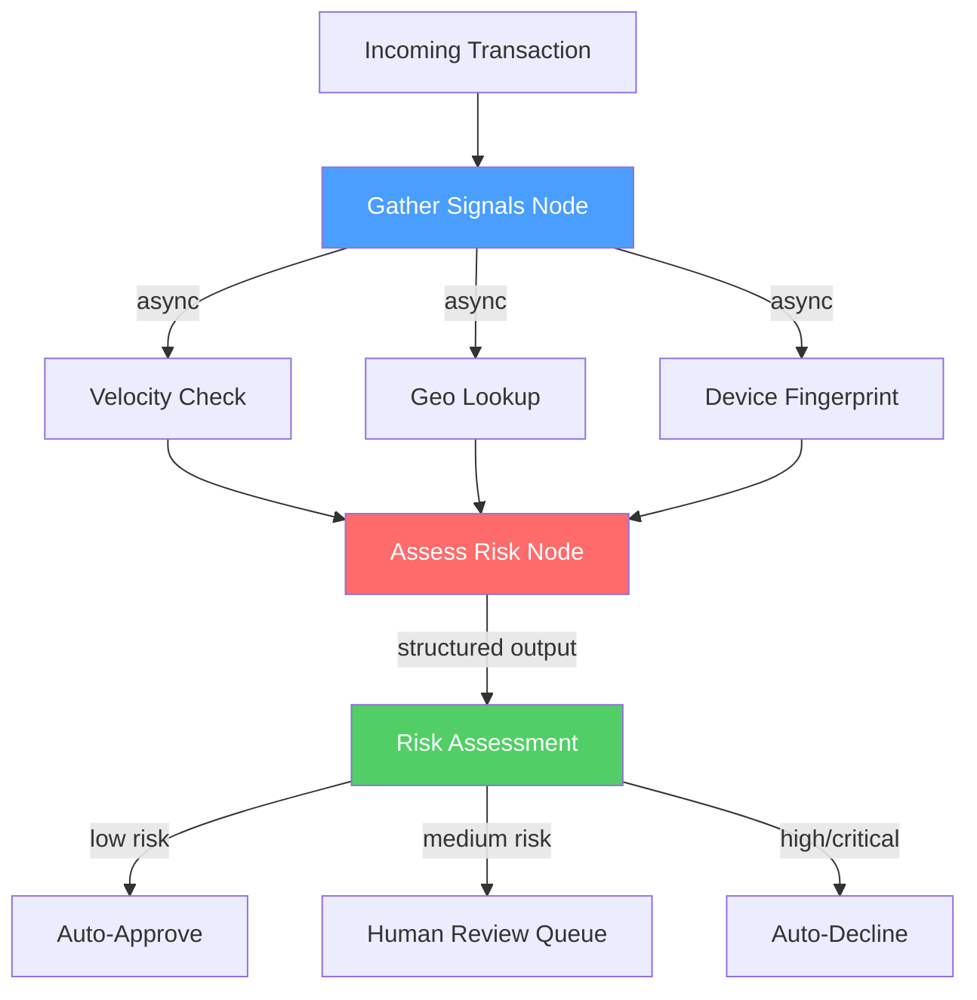
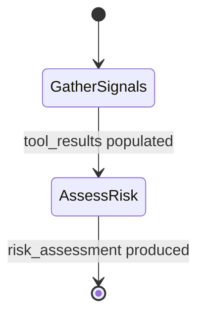
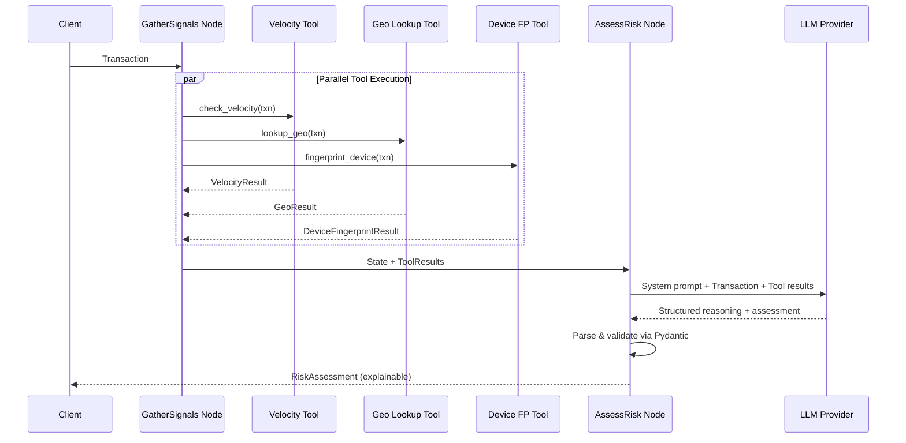

# Architecture: Transaction Risk Classifier

## System Overview



## LangGraph State Machine



The graph has two nodes with a simple linear flow. This intentional simplicity is the foundation — Project 2 expands this into a multi-agent graph with branching, debate, and escalation paths.

## Sequence Diagram: Agent Communication



## Data Flow

```
Transaction (Pydantic)
    │
    ├── customer_id, amount, merchant ──▶ VelocityCheck ──▶ VelocityResult
    ├── ip_address, billing_country ────▶ GeoLookup ─────▶ GeoResult
    └── device_id ─────────────────────▶ DeviceFP ──────▶ DeviceFPResult
                                                              │
                                         All 3 results ◀─────┘
                                              │
                                              ▼
                                     LLM Reasoning Engine
                                              │
                                              ▼
                                     RiskAssessment
                                     ├── risk_level (enum)
                                     ├── confidence (float)
                                     ├── reasoning_chain[] (explainable)
                                     ├── recommended_action
                                     ├── summary (human-readable)
                                     └── tool_results (raw data)
```

## Key Design Decisions

| Decision | Choice | Rationale |
|----------|--------|-----------|
| Orchestration | LangGraph | Explicit state, checkpointing, production-ready |
| Parallelism | asyncio.gather | 3x faster tool execution, critical for real-time |
| Data validation | Pydantic v2 | Type safety, schema enforcement, serialization |
| LLM abstraction | LangChain providers | Swap OpenAI/Anthropic without code changes |
| Output format | Structured JSON | Machine-parseable + human-readable |
