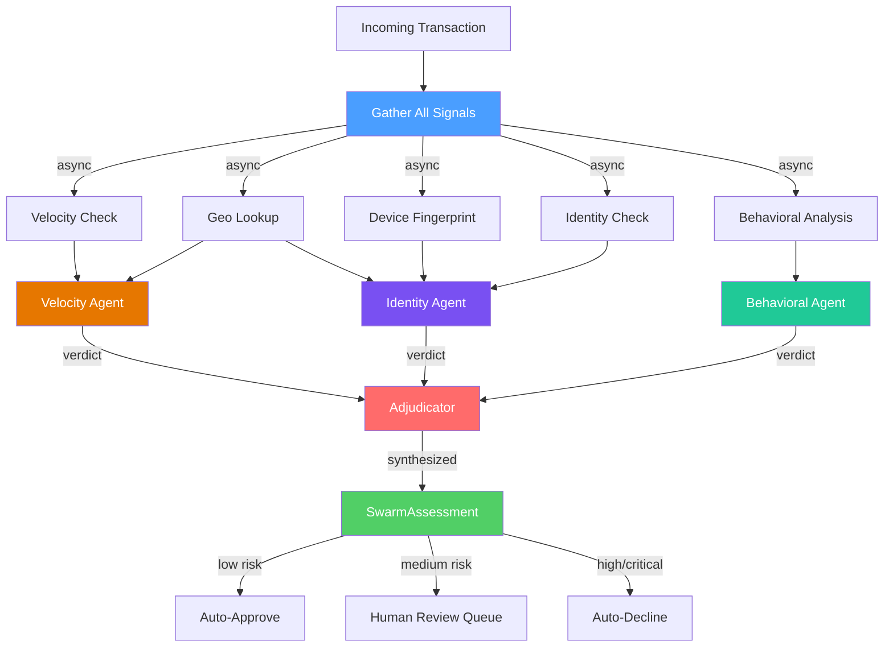
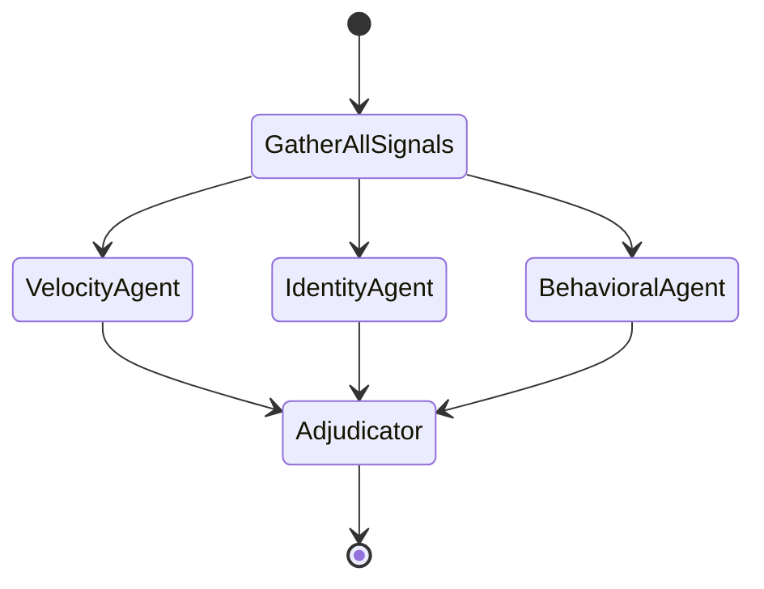
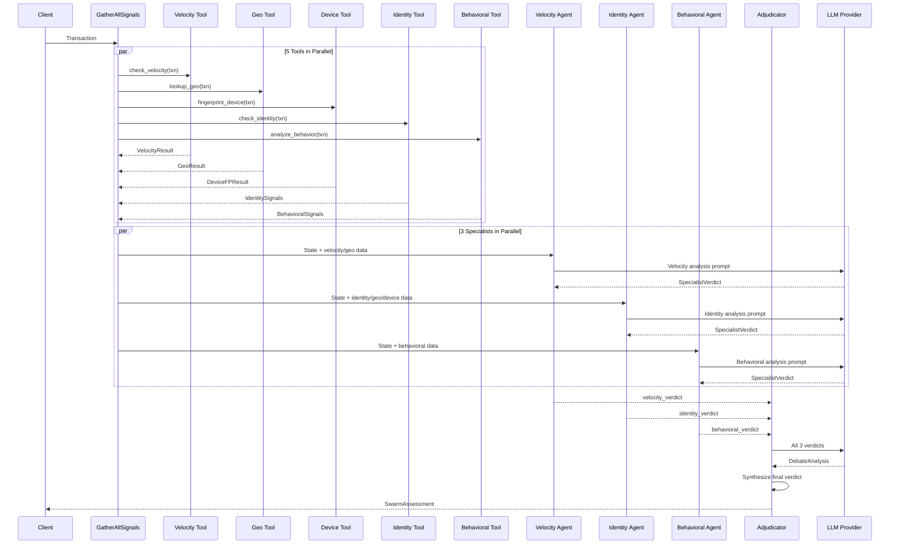

# Architecture: Fraud Detection Swarm

## System Overview



## LangGraph State Machine



The graph uses LangGraph's native fan-out edges. When `gather_all_signals` completes, all three specialist nodes execute in parallel. The adjudicator fires only after all three complete (fan-in). This is the key architectural difference from Project 1's linear two-node graph.

## Sequence Diagram: Multi-Agent Communication



## Data Flow

```
Transaction (input)
    │
    ├── amount, merchant, customer ─────▶ VelocityCheck ────▶ VelocityResult
    ├── ip_address, billing_country ────▶ GeoLookup ────────▶ GeoResult
    ├── device_id ─────────────────────▶ DeviceFP ──────────▶ DeviceFPResult
    ├── email, account, customer ──────▶ IdentityCheck ─────▶ IdentitySignals
    └── session, navigation ───────────▶ BehaviorAnalysis ──▶ BehavioralSignals
                                                                    │
                            All signals distributed to specialists ◀┘
                                        │
                    ┌───────────────────┼───────────────────┐
                    ▼                   ▼                   ▼
            Velocity Agent       Identity Agent      Behavioral Agent
                    │                   │                   │
                    ▼                   ▼                   ▼
            SpecialistVerdict   SpecialistVerdict   SpecialistVerdict
                    │                   │                   │
                    └───────────────────┼───────────────────┘
                                        ▼
                                   Adjudicator
                            ┌───────────┴───────────┐
                            ▼                       ▼
                    DebateAnalysis           SwarmAssessment
                    ├── agreement_score      ├── risk_level
                    ├── agreeing_agents      ├── confidence
                    ├── dissenting_agents    ├── recommended_action
                    ├── contention_points    ├── summary
                    └── resolution           ├── specialist_verdicts[]
                                             ├── debate_analysis
                                             ├── tool_results (raw)
                                             └── assessed_at
```

### State Isolation Pattern

Each specialist writes to its own key in `SwarmState` — no merge conflicts:

```
SwarmState (TypedDict)
├── transaction           ← input
├── tool_results          ← gather_all_signals writes
├── identity_signals      ← gather_all_signals writes
├── behavioral_signals    ← gather_all_signals writes
├── velocity_verdict      ← velocity_agent writes (exclusive)
├── identity_verdict      ← identity_agent writes (exclusive)
├── behavioral_verdict    ← behavioral_agent writes (exclusive)
├── debate_analysis       ← adjudicator writes
└── final_assessment      ← adjudicator writes
```

## Key Design Decisions

| Decision | Choice | Rationale |
|----------|--------|-----------|
| Topology | Fan-out/fan-in | Parallel specialist execution, single adjudication point |
| State isolation | Separate verdict keys per agent | Avoids LangGraph merge conflicts in parallel nodes |
| Debate resolution | Adjudicator + weighted synthesis | Context-dependent weighting beats simple majority vote |
| Disagreement handling | Conservative — bump toward "review" | Matches fintech risk tolerance; false positives < false negatives |
| Mock fallback | Per-agent mock functions | Each specialist has independent fallback; real/mock can mix |
| Model architecture | Same LLM for all agents (configurable) | Simplicity; could tier models per specialist for cost optimization |
| Tool execution | asyncio.gather for all 5 tools | ~0.3s total vs ~1.5s sequential; critical for real-time use |
