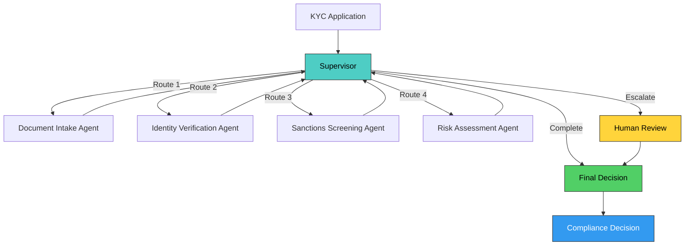
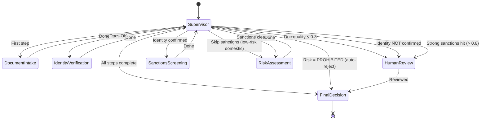
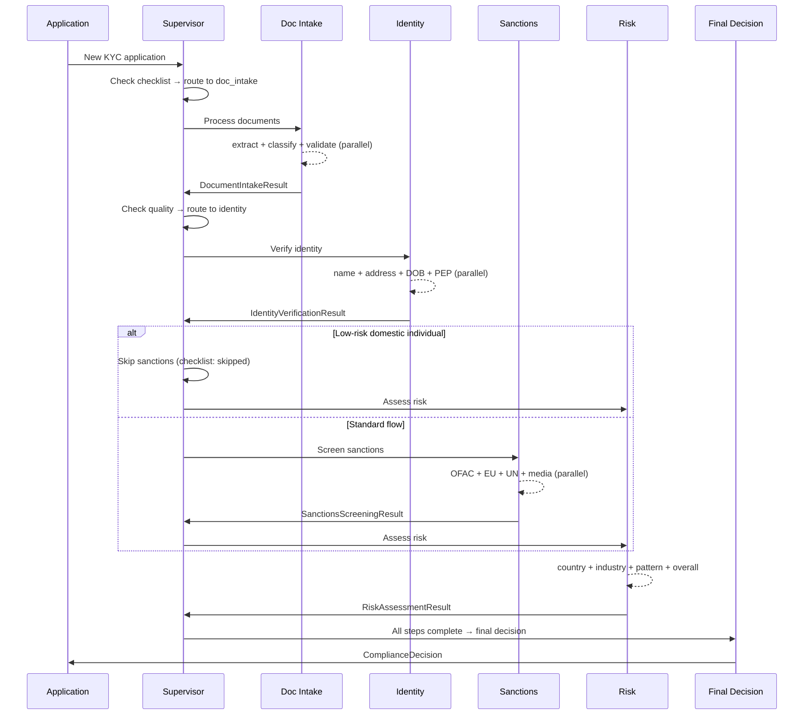

# Architecture — KYC/AML Compliance Platform

## System Overview



## Supervisor State Machine



## Sequence Diagram



## Key Design Decisions

| Decision | Choice | Rationale |
|----------|--------|-----------|
| **Graph topology** | Supervisor hub-and-spoke | Compliance workflows have dependencies between stages; fan-out is wrong here |
| **Routing mechanism** | `add_conditional_edges` | LangGraph's native conditional routing — cleaner than manual state checks |
| **State management** | State isolation per agent | Each agent writes to its own key (pattern from P2, prevents merge conflicts) |
| **Skip logic** | Supervisor-driven | Low-risk domestic individuals skip sanctions — reduces cost by ~15-25% |
| **Escalation** | 3 triggers → human_review | Document failure, identity failure, strong sanctions match |
| **Checklist tracking** | Pydantic model in state | Immutable audit of which steps ran, which were skipped, and when |
| **LLM fallback** | `_has_api_key()` check | Zero-cost development with deterministic mocks; real LLM when key is present |

## Data Flow

```
KYCApplication (input)
    │
    ├── Document Intake: 3 tools × N documents (parallel per-doc, parallel per-tool)
    │   └── DocumentIntakeResult → state.document_intake_result
    │
    ├── Identity Verification: 4 tools (parallel)
    │   └── IdentityVerificationResult → state.identity_verification_result
    │
    ├── Sanctions Screening: 4 tools (parallel)  [may be SKIPPED]
    │   └── SanctionsScreeningResult → state.sanctions_screening_result
    │
    ├── Risk Assessment: 4 tools (3 parallel + 1 sequential aggregation)
    │   └── RiskAssessmentResult → state.risk_assessment_result
    │
    └── Final Decision: aggregates all results
        └── ComplianceDecision (output with full audit trail)
```

## Portfolio Progression

| Dimension | P1: Risk Classifier | P2: Fraud Swarm | P3: KYC/AML Platform |
|-----------|-------------------|-----------------|---------------------|
| Topology | Linear (2 nodes) | Fan-out/fan-in (5 nodes) | **Supervisor hub-and-spoke (7 nodes)** |
| Routing | Static | Static parallel | **Dynamic conditional** |
| LangGraph API | `add_edge` | `add_edge` fan-out | **`add_conditional_edges`** |
| Agents | 1 | 3 specialists + adjudicator | **4 specialists + supervisor** |
| Tools | 3 | 5 | **15** |
| Skip logic | None | None | **Supervisor-driven** |
| Escalation | None | Mentioned | **Implemented (3 triggers)** |
| Domain | Transaction scoring | Fraud detection | **KYC/AML compliance** |
